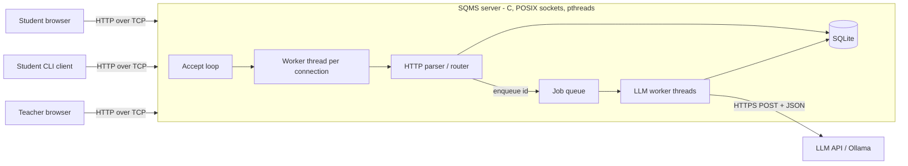
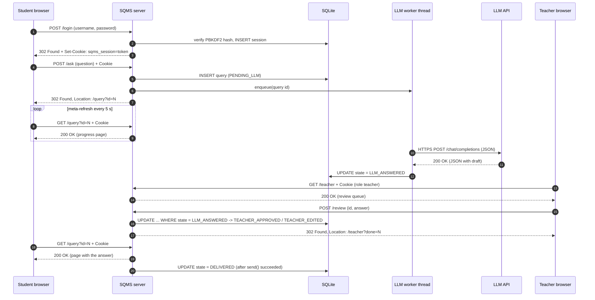
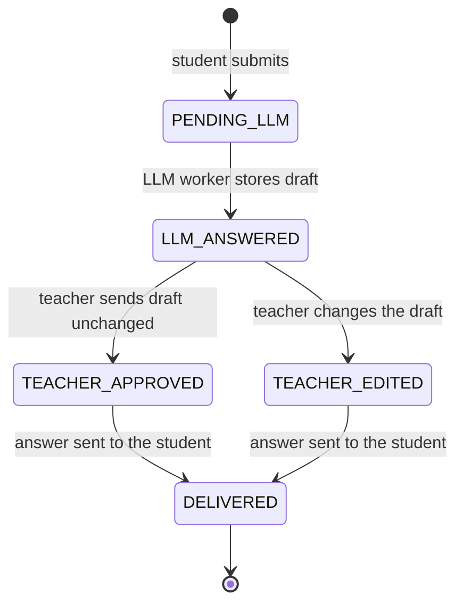

# SQMS: Architecture and Networking Concepts

**Student Query Management System: a multi-threaded client-server system with LLM-assisted,
teacher-verified answers.**

This document explains how the system is built and how each feature maps to a Computer Networks
concept. It is written to be reused in the project report and for viva preparation.

---

## 1. Overview

Students connect to a central server over HTTP and submit questions. The server stores each question,
sends it to a Large Language Model (LLM) for a draft answer, and puts the draft in a teacher's review
queue. The teacher approves or edits the draft, and the final answer is delivered to the student.



Everything between the network and the application logic is written by hand: socket setup, the
HTTP/1.1 parser and response builder, cookies and sessions, the HTML template engine, and SHA-256 /
PBKDF2 password hashing. Libraries are used only for storage (SQLite), for the outgoing LLM call
(libcurl, cJSON) and for the optional TLS layer (OpenSSL).

---

## 2. Components

| Component | File | Responsibility |
|---|---|---|
| TCP server | `src/server.c` | `socket/bind/listen/accept`, one thread per connection, connection cap, timeouts, graceful close |
| HTTP layer | `src/http.c` | Parse request line, headers, `Content-Length`, form bodies and cookies; build responses |
| Router | `src/router.c` | Map method + path to a handler; role-based access control; all pages |
| Sessions and accounts | `src/auth.c`, `src/crypto.c` | Salted PBKDF2-SHA256 passwords, random session tokens, cookie headers |
| Storage | `src/db.c` | SQLite tables `users`, `sessions`, `queries`; prepared statements; mutex |
| LLM drafting | `src/llm.c` | Producer/consumer job queue, worker threads, libcurl + cJSON, MOCK mode |
| HTTPS (bonus) | `src/tls.c` | OpenSSL TLS handshake and encrypted read/write |
| Rate limit (bonus) | `src/ratelimit.c` | Per-IP token bucket |
| CLI client | `client/sqms_client.c` | Raw-socket HTTP client: `getaddrinfo`, `connect`, hand-built requests |
| Load test | `tests/load_test.sh` | Many concurrent simulated students |

---

## 3. Message flow: one question from start to finish

Each arrow labelled with an HTTP method is a **separate TCP connection** (three-way handshake,
one request, one response, close), because the server sends `Connection: close`.



### Query state machine



Every transition is a single SQL `UPDATE ... WHERE id = ? AND state = <expected>`. A state can
therefore never move backwards, and if two teachers submit the same question at once, only the first
`UPDATE` matches; the second is told the question was already reviewed (`409 Conflict`).

**DELIVERED** is recorded only after the HTTP response carrying the answer has been written to the
student's socket. (A successful `send()` means the data reached the kernel's send buffer; TCP then
guarantees delivery or the connection fails.)

---

## 4. Feature → networking concept

| Feature in SQMS | Networking concept | Where |
|---|---|---|
| Server listens on port 8080 and accepts many clients | **Client-server model**, TCP **ports** and **sockets** | `server.c: create_listen_socket` |
| `socket()`, `bind()`, `listen()`, `accept()` | Server side of the **socket API**; the kernel completes the **three-way handshake** before `accept()` returns | `server.c` |
| CLI client `getaddrinfo()` + `connect()` | Client side of the socket API; **DNS/name resolution**; `connect()` performs the handshake | `client/sqms_client.c` |
| `SO_REUSEADDR` | Restart despite old connections in **TIME_WAIT** | `server.c` |
| Listen backlog 128 | Kernel **accept queue** of completed connections | `config.h` |
| Reading until `\r\n\r\n`, then `Content-Length` bytes | TCP is a **byte stream**, not messages; the application protocol defines **framing** | `http.c: http_read_request` |
| Request line, headers, status codes, `Content-Type` | **HTTP/1.1** (RFC 9110/9112), an **application-layer** protocol | `http.c` |
| GET with query string vs POST with body | **HTTP methods**, URL encoding | `/echo`, `http_form_get` |
| `302 Found` + `Location` after a POST | **Redirects**, Post/Redirect/Get | `router.c` |
| 400, 401, 403, 404, 405, 408, 409, 413, 429, 431, 500, 503, 505 | **HTTP status codes** | `http.c`, `router.c` |
| Session token in `Set-Cookie` / `Cookie` | **Sessions over a stateless protocol** | `auth.c` |
| `Connection: close`, one request per connection | **Connection management**; each request visible as its own TCP stream | `http.c` |
| `shutdown(SHUT_WR)` then drain then `close()` | **FIN** vs **RST**; four-way close; not losing the last response | `server.c: close_gracefully` |
| `SO_RCVTIMEO` / `SO_SNDTIMEO` | **Timeouts**; protection against idle or slow clients (slowloris) | `server.c` |
| `recv()` returns 0 / `ECONNRESET` | Peer closed with FIN / aborted with RST | `server.c`, `http.c` |
| `MSG_NOSIGNAL` and ignoring `SIGPIPE` | Writing to a closed connection must not kill the server | `server.c`, `main.c` |
| Thread per connection, connection cap, 503 | **Concurrent servers**; overload handling | `server.c` |
| `<meta http-equiv="refresh">` | Client-side **polling** (pull model) | templates, `router.c` |
| Server calls the LLM with libcurl | The server acting as an **HTTP client**; JSON over HTTPS; REST APIs | `llm.c` |
| `CURLOPT_TIMEOUT`, retries with backoff | **Unreliable remote services**, exponential backoff | `llm.c` |
| `/inspect` page | Seeing real request headers, client IP and **ephemeral port** | `router.c` |
| HTTPS with OpenSSL (bonus) | **TLS** between TCP and HTTP: handshake, certificates, encryption | `tls.c` |
| Per-IP rate limiting (bonus) | **Token bucket** traffic shaping / abuse protection; `429` | `ratelimit.c` |
| Codespaces port forwarding | **Reverse proxy**: client IP appears as 127.0.0.1, `X-Forwarded-For` header | `/inspect` |

---

## 5. Concurrency design

There are three kinds of threads:

1. **Main thread**: runs the `accept()` loop. It only accepts, applies the rate limit and the
   connection cap, and starts a worker. It never does slow work.
2. **Connection workers** (one per TCP connection, detached, at most `MAX_CONNECTIONS` = 64): read
   one HTTP request, handle it, send the response, close.
3. **LLM workers** (`LLM_WORKERS` = 2, started at boot): take question ids from the job queue and call
   the LLM.

**Why thread-per-connection?** Each connection's code reads top to bottom like a single-client
server, which keeps the HTTP code simple to write and explain. A slow client blocks only its own
thread. For a classroom-sized load (tens of clients) the per-thread cost is negligible. The known
weakness, unbounded thread creation, is handled by the connection cap: client number 65 gets an
immediate `503 Service Unavailable` with `Retry-After` instead of hanging. Alternatives would be a
fixed thread pool, or an event loop with `epoll`, which scales further but turns every handler into a
state machine.

**Why a separate LLM queue?** An LLM call takes seconds. If the `POST /ask` handler waited for it,
the student's browser would hang and one connection slot would be blocked per question. Instead the
handler saves the question, pushes its id onto a queue and answers at once. This is the
**producer/consumer** pattern:

```
 POST /ask threads (producers)        LLM workers (consumers)
   lock(job_lock)                       lock(job_lock)
   push id into ring buffer             while queue empty: wait(job_ready)
   signal(job_ready)                    pop id
   unlock(job_lock)                     unlock(job_lock)
                                        call LLM (no lock held)
```

It also caps simultaneous LLM calls at 2, however many students ask at once. On restart, questions
still in `PENDING_LLM` are re-queued from the database, so none are lost.

**Shared data and its locks**

| Shared data | Protected by | Why |
|---|---|---|
| Connection counters | `conn_lock` (mutex) + `conn_cv` (condition variable for shutdown) | Updated by the accept thread and every worker |
| SQLite connection | `db_lock` | One connection shared by all threads; each prepare-bind-step-finalize sequence is atomic |
| LLM job queue | `job_lock` + `job_ready` | Producer/consumer |
| Rate-limit table | `rl_lock` | Updated on every accepted connection |
| Log file | `log_lock` | Keeps lines from different threads from interleaving |

**Signals:** worker threads block `SIGINT`/`SIGTERM`, so Ctrl+C is always delivered to the main
thread and interrupts its `accept()` (the handler is installed without `SA_RESTART`). Shutdown then
closes the listening socket, waits up to 5 s for active connections, stops the LLM workers (aborting
in-flight libcurl transfers through a progress callback) and closes the database.

---

## 6. Robustness

| Threat | Defence |
|---|---|
| Client connects and sends nothing | `SO_RCVTIMEO` 15 s, then the connection is closed |
| Huge headers / huge body | 8 KB header limit (`431`), 32 KB body limit checked *before* reading (`413`) |
| Malformed request | `400 Bad Request`; the server keeps running |
| Too many clients | Connection cap → `503` + `Retry-After` |
| Client disappears mid-response | `SIGPIPE` ignored, `MSG_NOSIGNAL`, `send()` error handled |
| Partial `send()` | `conn_send_all()` loops until every byte is written |
| Response lost to RST on close | `shutdown(SHUT_WR)` + drain before `close()` |
| LLM down or slow | Timeouts, 3 attempts with backoff, then hand over to the teacher with a note |
| Flooding from one IP (bonus) | Token bucket → `429 Too Many Requests` |

---

## 7. Security (basic, as required)

- **Passwords**: PBKDF2-HMAC-SHA256, 100,000 iterations, 16-byte random salt per user; constant-time
  comparison; same response time for unknown users (no username enumeration).
- **Sessions**: 256-bit random token from `/dev/urandom`, stored server-side with an expiry; cookie
  flags `HttpOnly` (unreadable by JavaScript), `SameSite=Lax` (not sent on cross-site POSTs, against
  CSRF), `Max-Age`, and `Secure` under HTTPS. Logout deletes the session server-side.
- **Role-based access control**: every route is marked public / student / teacher / any user in one
  table; `check_access()` runs before any handler. Wrong role → `403`; not logged in → `302` to login.
  Students can only open their own questions.
- **Injection**: all SQL uses prepared statements with bound parameters; all user text is
  HTML-escaped before it is placed in a page (`{{var}}` escapes by default); redirect targets are
  checked for CR/LF (header injection); static file names are restricted (no path traversal).
- **Memory safety**: no fixed-size buffers for anything user-sized; a growable string buffer with
  overflow checks; `snprintf` everywhere; request sizes bounded.

---

## 8. Likely viva questions

**Why TCP and not UDP?** HTTP needs a reliable, ordered byte stream: a lost or reordered piece of a
form or a page would corrupt it. TCP provides this; UDP does not.

**What happens between `connect()` on the client and `accept()` on the server?** The kernel performs
the three-way handshake (SYN, SYN-ACK, ACK) and places the established connection in the listen
backlog queue. `accept()` takes it from the queue and returns a new socket for it, while the listening
socket keeps listening.

**How does the server know where one request ends?** Headers end at the blank line `\r\n\r\n`; the
body is exactly `Content-Length` bytes. The server keeps calling `recv()` until it has both, because
TCP may split or merge data arbitrarily.

**HTTP is stateless. How does the server remember who is logged in?** After login the server stores a
random token in the `sessions` table and sends it in `Set-Cookie`. The browser returns it in the
`Cookie` header on every request, and the server looks it up.

**Why use `Connection: close` rather than keep-alive?** It keeps each worker simple (one request per
thread) and makes every request a separate, easy-to-see TCP stream in Wireshark. The cost is an extra
handshake per request; keep-alive would be the optimisation for production.

**What is TIME_WAIT and why `SO_REUSEADDR`?** The side that closes first keeps the connection in
TIME_WAIT for 2×MSL so late packets are not mistaken for a new connection. Without `SO_REUSEADDR`,
restarting the server would fail with "address already in use" during that time.

**Why is the student page refreshing instead of the server pushing the answer?** Plain HTTP is
request/response: the server cannot send unless the client asks. Meta-refresh polling is the simplest
pull approach; WebSockets or Server-Sent Events would allow push.

**What if two teachers approve the same question at the same moment?** The update is
`WHERE state = 'LLM_ANSWERED'`, so the database applies only one; the second teacher gets `409`.

**What does HTTPS change in Wireshark?** Over HTTP the login password and cookie are readable in the
capture. Over HTTPS only the TLS handshake (Client Hello, Server Hello, certificate) and encrypted
application data are visible.

**What are the limits of this design?** Threads per connection cap scalability (an `epoll` event
loop would scale further); one SQLite connection serialises database work; the LLM queue is in memory
(recovered from the database on restart); the self-signed certificate is not trusted by browsers.
